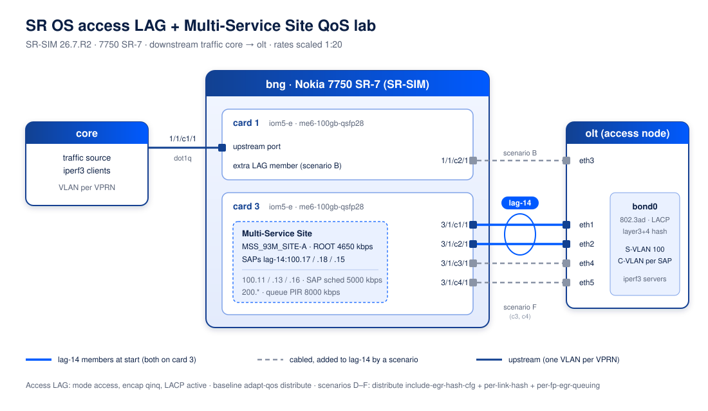

# SR OS access LAG + Multi-Service Site QoS lab

A [containerlab](https://containerlab.dev) lab on the Nokia SR-SIM (7750 SR-7, SR OS 26.7.R2) that shows how
egress QoS for SAPs on an access LAG is instantiated, and how SAPs and flows are spread over the LAG members, for:

- `adapt-qos distribute` with all members on one card (one forwarding complex)
- the same LAG spread over two cards
- `per-fp-egr-queuing` with `per-link-hash` (plain and `weighted auto-rebalance`)
- member failure / recovery and growing the LAG to four members

All raw CLI and traffic output is in [`results/`](results/).

## Questions this lab answers

1. With `adapt-qos distribute`, how many queue instances does a SAP get, and what rate does the
   Multi-Service Site (MSS) scheduler get on each card?
2. Can `per-fp-egr-queuing` be enabled on a LAG with VPRN SAPs, and what else is required?
3. With `per-link-hash`, how are SAPs placed on the members, and what does `weighted auto-rebalance` change?
4. What happens to the SAP-to-link mapping and to the MSS tree on member failure and recovery?

## Topology



Opening `sros-lag-mss-qos.clab.yml` in VS Code with the
[Containerlab extension](https://marketplace.visualstudio.com/items?itemName=srl-labs.vscode-containerlab)
shows the same topology in TopoViewer, with groups and notes from `sros-lag-mss-qos.clab.yml.annotations.json`.

- **bng**: `lag-14` (access, QinQ, LACP), initially `3/1/c1/1` + `3/1/c2/1` on card 3.
  Extra member ports are cabled but not in the LAG until a scenario adds them.
- **olt**: Linux `bond0` (802.3ad, `layer3+4` hash) that emulates the access node. Each SAP is an
  S-VLAN 100 / C-VLAN subinterface with its own IP address and policy route back to the BNG.
- **core**: one dot1q port, one VLAN per VPRN. It sends the downstream traffic, so the BNG egress on `lag-14` is the measured direction.

### Services and QoS (rates scaled 1:20)

| VPRN | SAP | QoS | Per-SAP address (olt side) |
|------|-----|-----|-----------------|
| 1001 | `lag-14:100.17` | MSS `MSS_93M_SITE-A`, queue → `ROOT` | 10.10.17.2/30 |
| 1002 | `lag-14:100.18` | MSS `MSS_93M_SITE-A`, queue → `ROOT` | 10.10.18.2/30 |
| 1003 | `lag-14:100.15` | MSS `MSS_93M_SITE-A`, queue → `ROOT` | 10.10.15.2/30 |
| 1004 | `lag-14:100.11`, `.13`, `.16` | SAP scheduler `SAP_100M_OUT` (ROOT 5000 kbps) | 10.10.11/13/16.2/30 |
| 1005 | `lag-14:200.*` | queue PIR 8000 kbps | 10.10.200.1/24 |

The MSS (customer 2, assigned to `lag-14`) uses scheduler policy `MSS_ROOT_OUT`, with ROOT overridden to
PIR = CIR = 4650 kbps. That is a 93 Mbps site at 1:20 scale. A 100 Mbps SAP becomes 5000 kbps.

Rates are scaled because the simulator forwards at most 1000 pps per port (see below). All configuration is in
[`configs/bng-base.cfg`](configs/bng-base.cfg) (MD-CLI, flat format).

## SR-SIM limitations

This lab validates **configuration, QoS hierarchy instantiation and SAP and flow distribution**. It does **not**
validate rate enforcement.

- *"The SR-SIM is designed to replicate control and management plane operations, and port throughput is
  limited to 1000 pps/port as a result."* (SR-SIM Installation and Setup Guide 26.7, Appendix B).
  Data plane functions that are implemented in FP hardware are not emulated.
- The scheduler hierarchy and the operational rates (`OperPIR`) are computed exactly as on hardware, but
  rates are **not enforced**. Scenario 0 sends 8 Mbps through a 5 Mbps SAP scheduler and gets 8 Mbps
  with zero drops ([`results/01-simulator-datapath.txt`](results/01-simulator-datapath.txt)). 26.7.R2 behaves the same as 25.10.R1.
- The ceiling of about 10 Mbps per port (1000 pps × 1200 B) is the only real limit. Where the offered load
  comes close to it, as in scenario B with 8.4 Mbps through the single core port, some streams show loss. Also, an
  iperf3 client sometimes fails to start (`FAILED`). Both are artifacts of the simulator and the test tool.
- Real shaping accuracy, burst and buffer behavior, latency, and satellite (ESAT) uplinks need hardware or a
  VSR with a throughput license.

## Results

### Scenario 0: simulator data path ([`01`](results/01-simulator-datapath.txt))

SAP `100.11` has its 5000 kbps scheduler with one queue per LAG member. 8 Mbps offered gives 7983 kbps received and
0 drops in the egress queue counters. 30 Mbps offered into `200.*` gives about 9.5 Mbps (the pps ceiling).

### Scenario A: `adapt-qos distribute`, both members on card 3 ([`02`](results/02-A-distribute-same-card.txt))

- One MSS `ROOT` on `slot(3)` with `OperPIR 4650 kbps`, which is 100% of the configured rate,
  because all members are on the same card.
- Each SAP has **one queue instance per member port** (`(3/1/c1/1)` and `(3/1/c2/1)`), each with full rate and its own MBS.
- Flows of one SAP are hashed per flow over both members. A single flow always uses one member.

### Scenario C: `per-fp-egr-queuing` on the existing LAG ([`03`](results/03-C-per-fp-egr-queuing.txt))

The commit is rejected for every VPRN SAP:

```
sap on a lag with per-fp-egr-queuing and per-link-hash disabled. not supported
```

For IES/VPRN SAPs, `per-fp-egr-queuing` needs `per-link-hash`. `per-link-hash` in turn needs
`adapt-qos link`, `port-fair`, or `distribute` with `include-egr-hash-cfg`.

### Scenario B: LAG over two cards, `adapt-qos distribute` ([`04`](results/04-B-two-cards.txt))

The MSS and SAP schedulers are instantiated **per card**, and the rate is split by the share of local members:

| Members | slot 3 ROOT | slot 1 ROOT | Sum |
|---------|-------------|-------------|-----|
| 2 × card 3 + 1 × card 1 | 3100 kbps | 1550 kbps | 4650 |
| 1 × card 3 + 1 × card 1 | 2325 kbps | 2325 kbps | 4650 |

The aggregate is correct only when traffic hashes in the same proportion as the members. A subscriber with
traffic mostly on one card is limited to that card's share. Traffic was spread over all three members (25/36/39%).

### Scenario D: `distribute include-egr-hash-cfg` + `per-link-hash` + `per-fp-egr-queuing` ([`05`](results/05-D-per-link-hash-per-fp.txt))

- The LAG has to be rebuilt: SAPs are removed, the LAG is reconfigured, and the services are re-added. The commit is then accepted.
- Each SAP has **one queue instance** on its assigned link. SAP scheduler `5000 kbps` and MSS ROOT `4650 kbps` are 100%.
- **Plain `per-link-hash` does not rebalance**: after bring-up, 6 of 7 SAPs were on `3/1/c2/1`.
  Traffic matched that, with 86% on one member.

### Scenario D2: `per-link-hash weighted auto-rebalance` ([`06`](results/06-D2-weighted-auto-rebalance.txt))

SAPs are redistributed at once to 4 / 3 over the two members, and traffic follows (57/43%).

### Scenario E: member failure and recovery ([`07`](results/07-E-link-failure.txt))

- Link down: all SAPs move to the remaining member. The MSS stays a single `ROOT` at 4650 kbps.
- Link up: after the auto-rebalance timer, SAPs are spread 3 / 4 again and traffic splits 43/57%.

### Scenario F: four members on card 3 ([`08`](results/08-F-four-members.txt))

SAPs are spread 2 / 2 / 2 / 1. The three MSS SAPs land on three different links and still share **one** MSS `ROOT`
(4650 kbps) on the forwarding complex. Traffic per member matches the SAP placement.

## Conclusions

1. With `adapt-qos distribute` and **all members on one card / FP**, MSS and SAP schedulers are
   instantiated once at full rate. The per-member queue instances are still governed by one scheduler.
   This design works as long as the LAG does not span cards.
2. When the LAG **spans cards**, `distribute` splits every scheduler rate by the local member share. An
   aggregate rate is then guaranteed only for evenly hashed traffic.
3. `per-fp-egr-queuing` gives one queue set and one hierarchy per FP. For VPRN SAPs it requires
   `adapt-qos distribute include-egr-hash-cfg` with `per-link-hash`. Each SAP is then on one link, so one
   SAP is limited to one member's bandwidth.
4. Use `per-link-hash weighted auto-rebalance`. Without auto-rebalance the SAP distribution can stay very uneven after bring-up or member changes.
5. A change from the current LAG to `per-fp-egr-queuing` is a **service-affecting rebuild** of the LAG and its SAPs.
6. Rate accuracy must be validated on hardware or VSR, because SR-SIM does not enforce rates.

## How to run

Prerequisites:

- containerlab ≥ 0.80, Docker, Linux or WSL2 with the `bonding` kernel module
- the SR-SIM image `registry.srlinux.dev/pub/nokia_srsim:26.7.R2` (or a later release)
- **your own SR-SIM license**, saved as `license26.txt` next to the topology file. It is not in this repo.
- `sshpass` on the host

```bash
sudo containerlab deploy -t sros-lag-mss-qos.clab.yml
bash run-all.sh            # about 10 minutes; writes results/*.txt
sudo containerlab destroy -t sros-lag-mss-qos.clab.yml --cleanup
```

Other helpers: `./sros.sh 'show lag 14'` (runs MD-CLI commands or a command file), `./ping-all.sh`,
`./traffic.sh <rate> <streams> <seconds> ip:port...`, `./mss-snap.sh`.

Note for SR OS 26.x: named SAP QoS policies need an explicit `policy-id` (or `qos md-auto-id
qos-policy-id-range`). `bng-base.cfg` sets them.

## File layout

```
sros-lag-mss-qos.clab.yml                    topology
sros-lag-mss-qos.clab.yml.annotations.json   TopoViewer layout, groups and notes
lab.env                                      node names and SAP addresses
run-all.sh                                   runs all scenarios -> results/
sros.sh  traffic.sh  mss-snap.sh  ping-all.sh  iperf-servers.sh
configs/
  bng-base.cfg     base BNG config (LAG, QoS, MSS, VPRNs)
  reset.cfg        removes services, QoS and lag-14 (used before scenario D)
  c-per-fp.cfg  b1-add-card1.cfg  b2-split.cfg  d-lag.cfg  d-weighted.cfg  f-4links.cfg
  port-c1-down.cfg  port-c1-up.cfg
  core-init.sh  olt-init.sh  olt-bond.sh   Linux node setup
results/           raw output of each scenario (SR-SIM 26.7.R2)
```
